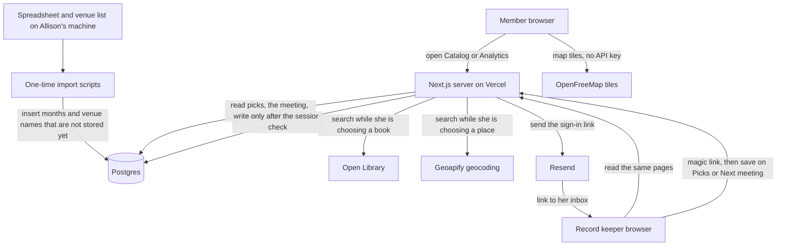

# Architecture

Paperback Riders is a small Next.js site. The catalog, Analytics, the editor, book lookup, and the single upcoming meeting are in the repo. This document is the architecture for that site, grounded in [the project brief](project-brief.md) and Linear stories ALL-135 through ALL-140, ALL-153 through ALL-155, ALL-167, and ALL-171. It is the source of truth for stack, data, and trust boundaries. Where a story still says something this document rejects, the story should change. The visible name of the second public page is Analytics. Book analytics and Paperback Rider Stats are retired names.

## Overview

Paperback Riders is a small public website for a book club of about twelve people. A member opens the catalog and sees the current pick, the next meeting and how many days remain, and the club's reading history in month order. From the catalog or from Analytics, the same pane moves them between the reading history and the reading totals and meeting map. Allison is the only person who enters or corrects a pick or the meeting.

A pick is one club month. It is either a specific book (title, author, publication year, cover, page count, genre) or a prompt (the prompt text, and none of the book fields). The pick the page features and the pick the next meeting discusses are the same kind of record. The current pick stays until its meeting has happened or been skipped. Then the next saved pick takes its place. If none is saved, the page says the next book hasn't been selected.

Allison edits those records on two tabs of the record-keeping page. The page opens on Picks, the months and their books or prompts. Next meeting is the other tab, and it is only the upcoming meeting. A member's page does not use those tabs. The current pick and the next meeting stay together there.

Catalog is the page a member gets by opening the site. Its address is `/`. Analytics is the other public page, at `/analytics`. Both pages show the same navigation pane by the header. The pane has two links, named Catalog and Analytics. It sits outside the masthead lockup, so on the catalog the club name stays the largest type and still reads Paperback Riders. The record-keeping page does not show the pane.

Analytics is where a member sees how many specific books the club has read, how many pages those books add up to, and every genre as a row of that group's covers, plus one pin for each place the club has met. Allison is the only person who records a venue name or chooses which real place that name means. Anyone with the link can view the page, the same way they can view the catalog.

Member-only email access, recommendations, member-created events, sorting, and filtering stay later. This design does not build seams for them. Analytics is three counts and a map of places. It is not charts, pace, or author rankings. The pane is two links. It is not a menu, a third page, or a way into the editor.

## Stack

| Layer | Choice | Why |
| --- | --- | --- |
| Language | TypeScript | One language for the pages, the editor, and the one-time imports |
| App | Next.js (App Router), Node.js runtime | The public pages are server-rendered HTML. Writes are server actions. Fluid Compute on Vercel is the default runtime; do not set the Edge runtime |
| Database | Postgres on Neon, via the Vercel Marketplace | The host has no durable disk. A decade of months is tiny; Postgres is here for a unique month, real foreign keys, and backups, not for scale |
| Queries and migrations | Drizzle | SQL-shaped, and Better Auth can use its Drizzle adapter |
| Auth | Better Auth, email magic link, sessions in our Postgres | One editor, data stays in our database, no second identity vendor |
| Email | Resend | Delivers that one magic link. The public pages never send mail |
| Book lookup | Open Library Search and Covers | Documented, key-free, and meant to be stored. Goodreads' public API stopped issuing keys on 8 December 2020 and is retired |
| Place lookup | Geoapify Geocoding API | Returns several matches, and the free plan allows production use and storing the result. The key stays on the server. Called only while Allison is choosing a place |
| Map | MapLibre GL JS and OpenFreeMap tiles | The browser draws pins from coordinates we already stored. The style URL needs no key and does not bill per view |
| Hosting | Vercel | Fits Next.js, preview URLs, and a Neon integration. Traffic for twelve readers fits a free tier |
| Tests | Vitest for the pure rules | Month selection, the day count, book-versus-prompt validation, the reading totals, the genre groups, and "a pin exists only after she selects a match" |

Still out on purpose: Redis, a cache CDN rule, object storage, PostGIS, a scraper, a queue, a hosted login product, and Google Maps.

## System diagram



The public pages read our database. The navigation pane is HTML on those two pages. It is not a service, and it does not read the database. Open Library and Geoapify are on the editor's search path only. The browser asks OpenFreeMap for tiles after we have already sent the pins. The imports never go through the website.

## Folder structure

What is in the repo today. The navigation pane is the piece this design adds.

```
app/
  page.tsx                  Catalog, the hero page
  public-masthead.tsx       shared club lockup for Catalog and Analytics
  public-page.tsx           featured pick, meeting, history
  public-nav.tsx            Catalog and Analytics pane, rendered by the two public pages
  analytics/page.tsx        reading totals, then the map
  edit/                     record-keeping route: Picks tab, Next meeting tab. No public pane
  api/auth/[...all]/        Better Auth route handler
lib/
  auth.ts                   Better Auth and requireRecordKeeper()
  db/                       Drizzle schema and client
  picks.ts                  featured pick, history, save, delete
  meeting.ts                the single next meeting
  reading.ts                book count, page total, genre groups
  visits.ts                 venue names, confirmed places, pins
  books/lookup.ts           Open Library adapter behind one function
  places/lookup.ts          Geoapify adapter behind one function
  validation.ts             rules shared by the editor and the imports
scripts/
  import-history.ts         local one-time load of months, not a route
  import-venues.ts          local one-time load of venue names, not a route
public/                     club logo, and later the prompt-month icon
drizzle/                    SQL migrations
```

The logo is `public/paperback-riders-logo.jpg`. The header shows the illustration on its own, `public/paperback-riders-mark.jpg`, beside the name set in type. The name is the larger part. It is branding, not data.

The two import scripts are not in the repo yet. They wait for the files Allison supplies.

## Data model

Stored things: a pick for each club month, at most one upcoming meeting, a confirmed real place, and one visit per month that has a venue name.

### Pick

One row per club month. `month` is the first calendar day of that month in the club timezone, and it is unique. That column is the identity of a month. There is no separate "current pick" flag and no second table for prompts.

| Field | Book month | Prompt month |
| --- | --- | --- |
| `month` | required, unique | required, unique |
| `kind` | `book` | `prompt` |
| `prompt_text` | empty | required |
| `title`, `author` | required | empty |
| `published_year`, `cover_url`, `page_count`, `genre` | optional | empty |
| `lookup_source` | `open_library` or `manual` | empty |
| `lookup_key` | Open Library id when she chose a match | empty |

A database check constraint enforces the split. A prompt row cannot carry a title, author, year, cover, page count, or genre. A book row cannot carry prompt text, and it must have a title and an author. The application validates the same rules before the write. The constraint is what still holds if a second write path forgets.

`genre` is one string, not a tag table. `page_count` is a whole number from 1 to 100,000 when it is present. `published_year` is an integer, not a date. Blank genre and blank page count are stored as null.

`lookup_key` remembers which book match she chose. The page does not call Open Library again to display the book. The stored fields are ours, including her corrections.

### Meeting

One row. Replacing the next meeting updates that row. The row holds the upcoming date, time, and the words members read on the dateline. The Next meeting tab reads and updates this row. Past dates and times are not stored, so the tab has nothing else to list.

| Field | Rule |
| --- | --- |
| `pick_id` | required, foreign key to a pick |
| `starts_at` | required timestamp, stored in UTC |
| `place` | required plain text, the words on the dateline |
| `updated_at` | set on every save |

She cannot save a meeting that points at nothing. A prompt month is a normal pick, so it can be the meeting's pick. A past meeting's date, time, and other event details are still out of scope. Saving a new meeting does not delete the visit recorded for an earlier month.

### Place and visit

A visit is one club month's venue. A place is one real bar, park, or other public spot, and it is one pin.

`visits` has one row per pick. `pick_id` is unique and references `picks`. Deleting a pick deletes its visit.

| Field | Rule |
| --- | --- |
| `entered_name` | required, the words she typed or the import stored |
| `place_id` | empty until she selects a match |

`places` has one row per confirmed real place.

| Field | Rule |
| --- | --- |
| `label` | required, the name from the match she selected |
| `latitude`, `longitude` | required, from that same match |
| `provider` | required, the geocoder adapter's name |
| `provider_id` | required, that geocoder's id for the place |

`provider` and `provider_id` together are unique. Two months become one pin when she selects the same provider id. Similar typed names stay separate until she does that. The map query is visits that have a place, so a place with no visits left does not draw a pin. Latitude and longitude are check-constrained to real ranges.

The browser never submits its own coordinates. Search returns a short list of server-signed candidates. Saving a visit sends one of those candidates back. The server checks the signature and the expiry, then writes that candidate's label, coordinates, and provider id. A visit with no selected candidate keeps `entered_name` and an empty `place_id`.

### How the page chooses what to show

All date logic uses one IANA timezone, `CLUB_TIMEZONE`, set to `America/Los_Angeles`. "Today" and "this month" are that zone's calendar, not UTC.

**Current pick.** The pick at the top of the catalog, labeled Current pick. It stays while its meeting is scheduled, unscheduled, or not saved yet, including after the club month has turned. A new month does not release it. It is released when its organized meeting's date is before today in `America/Los_Angeles`, or when it is marked happened or skipped. That happened memory stays on the pick after the meeting row is replaced. A skipped pick stays skipped. A meeting dated today or later holds its own pick, even when a later pick is saved and even when an earlier pick was never marked. That hold lasts through a month boundary while the meeting date is still today or ahead. The day after that date, the next saved pick becomes current, even before its month starts. A pick beyond that one waits. If no meeting is saved, or the meeting has no date, an unmarked pick stays across a month boundary. If nothing is saved after the released pick, the hero reads "The next book hasn't been selected. Watch this space." and the history marks no row. A club with no picks at all is empty, which is different from that sentence and from a database error. Loading a page does not mark a pick happened because its month is past. Only a stored meeting date before today does that.

**History.** Every pick, ordered by `month` descending, newest first. The list is short (a row per month, not per member), so the page renders all of it. No pagination, sort control, or filter. A future month she has already entered appears in that order.

**Next meeting.** One row. It discusses the current pick. Scheduled means a date, a time, and a place. Unscheduled means those three are unknown together, and members read "Date and place to come," then the book or the prompt, with no day count. A stored date before today is not the next meeting. The page then says "No upcoming meeting is set." She can mark the current pick skipped. The site does not announce that. The next saved pick becomes current, and the meeting for it is unscheduled. With no next pick, the hero is the waiting sentence and the meeting row is cleared.

**Days remaining.** The meeting's calendar date minus today's calendar date, in the club timezone. Today is 0. This is a date difference, not a count of 24-hour periods, so a 7pm meeting still counts as today. The number is computed when the page is rendered.

A meeting dated today or later keeps its own pick as the current pick. Saving the next book does not replace that meeting. The morning after the date, the next saved pick is current and the dateline says no meeting is set until she saves the new one.

**Reading totals.** Computed when Analytics is rendered, from the current pick and every earlier pick. A pick still waiting is left out. When the catalog is unselected, every saved pick is included. The calendar month does not decide this.

- Book count: every row with `kind = book`.
- Page total: the sum of `page_count` on those books. Null adds nothing. The book still counts.
- Genres: books with a non-empty genre. Group by the trimmed genre, compared case-insensitively, after a parenthetical note is removed, so "Nonfiction (travel / memoir)" and "Nonfiction (self-help / relationships)" are both Nonfiction. A longer name that merely shares a word, such as "Fantasy" and "Fantasy romance", stays separate. The chart uses the genre stored on the pick. The label shown is the spelling that occurs most often in that group. Order by count descending, then label ascending. Gothic horror is counted as Horror. Every group is on the chart. Each group is one horizontal bar, with the genre name to the left. The bar is one cover per book, every cover forced to the same width and height, set in a row so the length is the count. A book with no usable cover still takes a tile. The row also shows the book count and that count as a percentage of every book in the totals. The covers sit 2px apart. A cover is shown only when it is an https image on covers.openlibrary.org, or the club's own file for The Wicker Husband.
- A prompt month is in none of the three.

A database error renders an error, never zeroes. Zeroes would read as "the club has read nothing."

**Pins.** One pin per place that has at least one visit on a reached pick: the current pick and every earlier one. A confirmed place on the current pick shows even when that month has not started. A pick still waiting does not pin. Unresolved names are not pins. Hover shows the covers of the book visits at that place, using the same cover-host rule as the rest of the site. A prompt visit has no cover until Allison supplies the icon. Click lists every included visit, newest month first: a book shows title, author, and the club month; a prompt shows the prompt text and the club month.

### Public page layout

This is the layout to build. It is the masthead chosen in the prototype. Do not build the countdown poster or the history-as-the-page. The prototype folder is a reference, not the implementation.

This page stays one column. The Picks and Next meeting tabs are only on the record-keeping page, below. They are not a second layout for members.

**Navigation pane.** Both public pages render `app/public-nav.tsx` after the lockup, outside `header.brand` and outside `.logo`, in the content column. The header does not contain it. The root layout does not render it, and the routes are not moved into a shared layout to get there. A layout on the root would also wrap `/edit`. The links are Catalog (`/`) and Analytics (`/analytics`). They are links, not headings. Both public pages use the same lockup from `app/public-masthead.tsx`: the `h1` is Paperback Riders, set on two lines, with the mark. The Analytics document title is `Analytics · Paperback Riders`. The club name on these pages is not a link. The Analytics banner, the club-name back link, and the title Book analytics go away. The pane is the only way between the two pages. It is static HTML. It does not read the database and it does not check a session, so it still renders when that page's data fails and the member can leave. Two links stay visible. There is no menu button.

At every width the lockup comes first, then one `3px` ink rule, then the two links as tabs under that rule. The rule is the nav's top border. The section under the nav does not draw a second rule. On a narrow screen the lockup stays name, then mark, and the two tabs stay one row. The lockup stays centered, the mark stays with the name, and the name stays the largest type. The pane does not sit inside `.logo`, beside the name, or between the name and the mark. The link for the page the member is on is marked: `aria-current="page"`, an ink fill, and paper-colored text. The other link is an ink outline with ink text and no fill. Neither link uses the bibliography underline.

Top to bottom on the catalog:

1. **Header.** The lockup is this band. The navigation tabs sit under it, after the header, under one `3px` ink rule. The name Paperback Riders is set in type, on two lines, in capitals, and it is the largest part of the header. The illustration is `public/paperback-riders-mark.jpg`, cropped from `public/paperback-riders-logo.jpg` so the drawn letters are not in the file. On a wide screen the illustration sits to the left of the name and is smaller than the name. On a narrow screen, inside the lockup, the name comes first and the illustration sits under the name. The tabs stay one row under that stack. The month, the date, and the pick label do not sit under the illustration. The page background is the logo's cream, `#efd2a6`, so the illustration does not sit in a box.

2. **A rule, then the current pick.** The label sits immediately above the cover. The words are "Current pick". On a wide screen the cover sits beside the title. On a narrow screen the cover comes first, then the title. A book shows the title, the author, then one line for publication year, page count, and genre, omitting any of those that are empty. A prompt shows the prompt text and none of those fields. When the next pick has not been saved, that spot reads "The next book hasn't been selected. Watch this space."

3. **The meeting is a dateline under that title.** It is not its own hero and not a giant day count. A scheduled meeting leads with the days remaining (Meets in 10 days, Meets in 1 day, or Meets today), then the date, the local time, the place, and the pick being discussed. An unscheduled meeting leads with "Date and place to come," then the book or the prompt, and shows no day count. When there is no upcoming meeting, that same dateline says "No upcoming meeting is set." and shows no date and no day count.

4. **The history is a bibliography under the pick.** A ruled list, not cards. Newest month first. Each book row is a small cover, the month, the title, then the author on its own line. Page count and genre sit apart from the author, and a missing genre is omitted. Publication year stays on the current book's line. The current pick's month is in the list and is marked, including before that month starts. When the catalog is unselected, no row is marked. A prompt row is set in italics and has no cover. A month can carry one additional book. That book is the next row, with the same month, and it counts in the reading totals once that pick is reached. The current pick stays the month's main book.

Analytics is `/analytics`. Its header is the same lockup as the catalog, and the same tabs sit under that lockup. On that page the three totals are server-rendered HTML. The map is a client component under them and receives only confirmed pins. If the map library or the tiles fail, the totals stay and the map area says it could not load. An empty set of pins is a sentence that no places are confirmed yet, which is different from a database error.

### Record-keeping page

The record-keeping page is one route, `/edit`. It has two tabs. Opening `/edit` shows **Picks**. **Next meeting** is the other tab. Members never see this page. The catalog still renders the featured pick and the meeting dateline in the same response.

The editor does not render the public pane. Its masthead is its own header. The club name there is a link to the catalog, which is how Allison leaves the editor. That link is not the Catalog item of the public pane, and this page does not grow an Analytics link.

**Picks** is the month list and the form for one month. The month is a book or a prompt, under the same rules as the pick table. She adds a month, corrects one, or deletes one she entered by mistake. Venue matching, when it is built, lives on the selected month here. That save writes the visit for the month. It leaves the meeting row alone. The meeting's dateline words can be offered as that month's venue name. Changing the dateline later still does not move a pin she already confirmed.

**Next meeting** is the upcoming meeting: the date, the time, the words members read on the dateline, and which stored pick the meeting discusses. A prompt month is a normal choice. The list of choices is how she points this one row at a month. It is not a list of past meetings. If no month is saved yet, the tab tells her to save a pick first. Saving updates the single meeting row and does not write a visit or a pin. The place field keeps the warning that anyone with the link can read those words.

The page loads the pick list and the meeting row on that one request. Hiding a tab is not a second fetch and not a cache. Twelve months do not justify a round trip per tab. A meeting that fails to load leaves Picks usable. Months that fail to load leave the meeting unsavable, because a meeting has to point at a pick.

The selected tab is part of the address. A save redirects back to `/edit`, so a tab remembered only in the browser would land her on Picks and hide the confirmation. With no tab selected in the address, the page shows Picks. Choosing a month stays on Picks. Saving the meeting returns to the Next meeting tab and shows that save's confirmation on that tab. The confirmation and the selected tab are different facts. An old confirmation address is not what opens the tab, and opening the tab does not display a confirmation she did not just make. Changing tabs does not write. Each tab posts its own form.

The tabs are the layout of this page. They are not a new route, a new table, or a new permission. Sign-in still decides whether the forms render. Each save still checks the session inside the write.

### Writes

On the Picks tab, Allison can add a month, correct a month, or delete a month she entered by mistake. Deleting the pick the meeting points at is refused until she points the meeting at another pick or replaces the meeting. On the Next meeting tab, she can add or replace the next meeting. On the selected month in Picks, she can store a venue name and select a place match for it. Members have no write path.

There is no `club_id`. This is one club. A tenant column would be a guess about a second club.

## External services

| Service | When it is called | If it is down |
| --- | --- | --- |
| Neon Postgres | Every page view and every save | The page shows a load error. It must not show an empty history or zero books, which would look like the club has read nothing |
| Open Library | Only while the signed-in record keeper searches for a specific book | She types the fields herself. Search failure does not block save. The public pages do not call Open Library |
| Geoapify | Only while the signed-in record keeper searches for a venue | The meeting's words can still be saved. No pin is written. Pins already stored still render |
| OpenFreeMap | The member's browser requests tiles while Analytics is open | The totals still render. The map area says it could not load. Our server does not see the tile request |
| Resend | Only to send her sign-in link | The public pages still load. Editing waits until mail works |

Open Library search returns a short list. The server does not choose the first hit. She picks one match, or she picks none and types the book. The adapter copies title, author, first publication year, a cover URL on `covers.openlibrary.org`, page count when the record has one, and at most one subject as a suggested genre. She can change any of those before save. A prompt month never searches.

Goodreads is not a dependency. Its developer API has been retired since December 2020. Scraping the site, or calling the website's own undocumented search, is out of the design: the terms forbid harvesting, a layout change would break entry, and a stored Goodreads copy is not a catalog we are allowed to keep. Ratings and reviews are not in v1 anyway.

Geoapify is the place matcher. The adapter sends one venue name and asks for a handful of results, biased toward `CLUB_PLACE_BIAS` so nearby bars and parks come first. Distant matches stay in the list, because a meeting outside that neighborhood is still allowed. The server does not pick the first result. One result is a list of one, and she still selects it. Zero results leave the visit unresolved. There is no per-keystroke autocomplete. The free plan allows this volume in production and allows the coordinates to be stored. The page shows OpenStreetMap attribution and a "Powered by Geoapify" link, which the free plan requires. Their terms also say commercial production use of the free package has limitations and to ask them; this club site is not a business, and the call volume is a few editor searches, not map views. If that plan ever stops fitting, replace the adapter. The stored pins stay.

Google Maps is rejected for this page. Geocoding results may be cached for 30 days and may not be drawn on a non-Google map, and a public Maps JavaScript load is billed per view with no login in front of it. The public Nominatim service is rejected too: a list of past venues is the bulk use its policy discourages, and the service can be withdrawn. OpenCage's free tier is for testing; the paid plan starts at $50 a month for a workload this small.

OpenFreeMap serves the tiles at `https://tiles.openfreemap.org/styles/liberty`. MapLibre shows the style's attribution. The style URL is the seam if that host goes away. Pins do not move with it, because the coordinates are in our database. OpenFreeMap has no uptime contract. That is an acceptable risk for twelve readers, and it is cheaper than proxying every tile through our server.

## Auth & authz

Reads are anonymous. Catalog and Analytics do not create a session and do not check one. The navigation pane is the same: two links, no session, and no link to `/edit`.

Writes are the record keeper only.

- Better Auth issues an email magic link to one address, `RECORD_KEEPER_EMAIL`, set in server configuration.
- Any other address fails closed. Public sign-up is off.
- There is no shared club password. A password that reaches the group text would make every member an editor.
- The session cookie is httpOnly, Secure, and SameSite. The session lives in Postgres.
- The edit screen can check the cookie to decide what to render. That check is not the authorization. Both tabs render only after it. Asking the address for the Next meeting tab still shows the sign-in page when no session is present. `requireRecordKeeper()` runs inside every function that inserts, updates, or deletes a pick, the meeting, a visit, or a place, and it re-reads the session and the allowlisted email. A hidden tab does not grant that write.
- The import scripts are not a login. They run with the database credentials on a trusted machine.

No member table, no roles beyond "this email is the record keeper," and no client-side flag that grants a write.

### Trust boundaries

| Boundary | Rule |
| --- | --- |
| Public pane | Two same-origin links, Catalog and Analytics. No edit link, no session, and no query string. The editor does not render the pane |
| Browser → server | Prompt text, place words, venue names, and book fields are plain text. React renders them as text. The map popup and the hover do the same: text nodes, not an HTML string. There is no markdown and no HTML body |
| Server → database | The write functions are the gate. A new screen cannot write by calling the database helper directly unless that helper checks the session. A place row is written only from a candidate the server signed |
| Server → Open Library | The server may request only the documented Open Library search and cover hosts, and only from the signed-in editor's search action. There is no public search URL |
| Server → Geoapify | The server may request only the Geoapify geocoding host, and only from the signed-in editor's place search. The key is not in the browser. Unresolved names are not in the public pin payload |
| Browser → OpenFreeMap | The map asks that host for tiles. The request reveals the viewer's IP and the area on screen to OpenFreeMap and its CDN. No geocoder key is attached |
| Cover images | The image optimizer's remote allowlist is the Open Library cover host. A cover URL on any other host is not fetched. The book saves without that cover. The map uses that same rule. The Wicker Husband cover is a file on this site, `/covers/the-wicker-husband.png`, and is not fetched from another host |
| Secrets | `DATABASE_URL`, `BETTER_AUTH_SECRET`, `BETTER_AUTH_URL` (production only), `RECORD_KEEPER_EMAIL`, `RESEND_API_KEY`, and `GEOAPIFY_API_KEY` stay on the server. None of them are `NEXT_PUBLIC_` |
| Logs | Log a failure with the pick id. Do not log the magic link, the session token, the auth secret, the database URL, the geocoder key, or the raw venue query |

The meeting's place words are public because the site is public. A confirmed pin is a precise public coordinate, which is a sharper copy of the same fact. The confirm step tells her that, and the place should be a public bar, park, or similar. See the security findings. The design does not add member names, phone numbers, or emails.

## Key data flows

### Move between Catalog and Analytics

A member is on either public page. The pane is already in the HTML. Choosing Catalog requests `/`. Choosing Analytics requests `/analytics`. Neither request sends a session or reads the database for the pane itself. The destination page then loads by its own flow below. Opening the site, with no path, is the catalog. The editor is not a destination of this pane.

### View this month's pick

A member requests the catalog. The server resolves the current pick as defined above and renders it in the layout above. A book shows title, author, publication year, cover, page count, and genre, omitting any field that is empty. A prompt shows the prompt text and none of the book fields. The label above the cover is Current pick. This response does not call Open Library.

### View the next meeting and the days remaining

The same request loads the meeting row and renders it as the dateline under the current pick. The record-keeping tabs are not involved. If its club-timezone date is today or later, the page shows that date, the local time, the place, the pick the meeting points at, and the day count. If the date, time, and place are all unknown, the dateline says "Date and place to come" and names the book or the prompt. If the row is missing or the date has passed, the page keeps that dateline and shows the sentence "No upcoming meeting is set." It does not show a negative count and it does not invent a date.

### View the history

The same request loads every pick ordered by month, newest first, and renders them as the bibliography in the layout above. The current month is in the list as well as in the hero. Sorting, filtering, and trend analytics are not controls on this page.

### See how much the club has read

A member requests `/analytics`, from the pane or by opening that address. The server loads the picks for the current club month and earlier and renders the book count, the page total, and the genre chart from the rules above. Prompt months are absent. A missing page count or genre is skipped for that field only. This response does not call Open Library, Geoapify, or the tile host. The totals do not wait for the map.

### Record a venue and choose the place

Allison opens `/edit` on the Picks tab. The page sends her a magic link if she has no session. She selects the month, which may be the meeting's month or an earlier one, and submits a venue name. The dateline words from the Next meeting tab can be offered as that name. Changing those words later does not move a pin she already confirmed.

The server action checks her session, asks Geoapify once, and returns a handful of signed candidates. She selects one, or she changes the name and searches again. Selecting writes the place, reusing the row when that provider id already exists, and points the visit at it. A search with no matches, a search that fails, or a candidate she does not select leaves no coordinates. This form is on the month in Picks. It is not on the Next meeting tab. Members never see it, and they never see unresolved names.

### See where the club has met

The same analytics request loads confirmed visits for the current club month and earlier, grouped by place, and passes that JSON to the map. One place is one pin. Hover shows the book covers stored for those visits. A prompt visit contributes no image until the icon file exists. Click lists each visit: title and author, or the prompt text, plus the club month. The list is newest month first.

### Record a book or a prompt

Allison opens `/edit` on the Picks tab and chooses a month and a kind.

For a book, she can search. The server action checks her session, asks Open Library, and returns a handful of matches. She selects one or skips. The form is then ordinary fields she can correct. Save validates the book rules, checks the session again, and upserts that month. A second save of the same month updates the row. Search being down or returning nothing leaves every field editable.

For a prompt, the form is the prompt text. Save clears the book fields and does not search.

### Record the next meeting

On the Next meeting tab the form is for the current pick. She sets a date, a time, and a place, or she marks the date and place as not set yet. She can skip the meeting. Skip is remembered on that pick, the site does not announce it, and the next saved pick becomes current with an unscheduled meeting. Save checks the session and updates the single meeting row. The redirect returns her to that tab with the confirmation. Members never see this form. The visit for that month is a separate save on the Picks tab, described above.

### Load the spreadsheet once

Allison provides the file outside the site. Someone with production database access runs `scripts/import-history.ts` locally. The script is written after the real columns are known. It maps each row into the same validation as the editor, then inserts a month that is not already stored. It does not update a month that exists, so a re-run cannot duplicate rows or overwrite her later edits. It is not an HTTP route, and the file is not committed. A member-facing upload is out of scope.

### Load past venue names once

Allison provides the venue list outside the site, one name per club month. Someone with production database access runs `scripts/import-venues.ts` locally, after the month import. The script inserts `entered_name` for a month that has a pick and does not yet have a visit. It does not update a visit that exists, and it does not call Geoapify. She selects matches afterward on the Picks tab. The file is not committed. A member-facing upload is out of scope.

## Infrastructure & deployment

- Production deploys from the main branch on Vercel. The build runs the unit tests and the Next.js build.
- Preview deployments and local development use their own Neon branch, not the production database. A preview save must not change the live pick, meeting, or pins. The app opens `DATABASE_URL` only after that check: a Vercel production deployment (`VERCEL=1` and `VERCEL_ENV=production`) may use the production host, and every other runtime refuses when the host matches `PRODUCTION_DATABASE_HOST`. The one-time import is the local exception. It accepts only that host, and it does not run on a deployment.
- Preview URLs use Vercel Authentication with deployment type `preview`, so an anonymous visitor cannot open a preview. Production stays readable with no sign-in. Do not protect all deployments. This stays preview-only even while production is a `vercel.app` host with no custom domain. Standard Protection (`all_except_custom_domains`) would also lock that host.
- The imports run against production only, from a trusted machine, after backups are on.
- Turn on Neon's automated backups and confirm a restore once, before the first import. The restore target is a non-production database. `CATALOG_RESTORE_HOST` is that host with no user or password, and the import refuses until it is set to a host other than production. Keep the spreadsheet and the venue list in Allison's own files. The repository ignores spreadsheet files.
- The public pages are rendered per request. Do not add ISR, a cache tag layer, or Redis. The read is a few small queries, and a cache would let "days remaining," a save she just made, and a pin she just confirmed go stale. Twelve readers do not create a hot path.
- Node.js runtime only.
- Observability is Vercel's function logs plus the explicit database-error state on each page. No separate monitoring product.
- Dependency versions stay locked. The image allowlist, the geocoder host, and the auth secret are reviewed when those files change.
- Expected spend is the free tier of Vercel, Neon, Resend, and Geoapify. OpenFreeMap is free and has no bill. The cost risk is a map widget billed per public page view, a scraper, a cache, or a second hosted login. It is not the database and it is not a few dozen geocoding calls.

Environment:

| Name | Where |
| --- | --- |
| `DATABASE_URL` | server, different value per production, preview, and local |
| `PRODUCTION_DATABASE_HOST` | server, the production Neon host with no user or password. Preview and local refuse `DATABASE_URL` when it is this host. The import accepts only this host. This is the database the backup is for |
| `CATALOG_RESTORE_HOST` | the trusted machine that runs the import. The non-production host of the one confirmed restore, with no user or password. The import refuses when it is missing or when it is the production host |
| `BETTER_AUTH_SECRET` | server |
| `BETTER_AUTH_URL` | production domain only. The app reads it only on the production deployment. Preview and local ignore it, so a copied value still sends the sign-in link to the request host |
| `RECORD_KEEPER_EMAIL` | server |
| `RESEND_API_KEY` | server |
| `GEOAPIFY_API_KEY` | server |
| `CLUB_TIMEZONE` | server, `America/Los_Angeles` |
| `CLUB_PLACE_BIAS` | server, `latitude,longitude` near where the club usually meets. Place search refuses to run when it is missing or not two coordinates. It is not a secret |

## Open decisions

The club timezone (`America/Los_Angeles`), the empty-meeting sentence ("No upcoming meeting is set."), book lookup (Open Library), place lookup (Geoapify, drawn with MapLibre and OpenFreeMap), and the public pane are settled. The pane is Catalog and Analytics on the two public pages only. At every width it is a row above the lockup. The current page's link is marked. The visible name is Analytics. These remaining items do not change the shape of the system. They need a person, not another component.

- **Spreadsheet columns.** The history import waits for the real file. Columns are not guessed here.
- **Venue list columns.** The venue import waits for the real list. A month plus a name is the shape it has to produce. The column headers are not guessed here.
- **Where the club usually meets.** `CLUB_PLACE_BIAS` needs a latitude and longitude from Allison. The architecture does not guess the city.
- **The prompt-month icon.** Allison will supply the file later. Until it is in `public/`, a prompt visit is in the click list and has no hover image.

## Known constraints & tradeoffs

- **Public reads, one editor.** Member-only access is later. The site does not carry a half-built account system. The meeting place and every confirmed pin are world-readable, so what gets confirmed matters. See the security findings.
- **Open Library instead of Goodreads.** Chosen because a retired API and a scraper are not a catalog. The lookup function is one module, so a different source later does not rewrite the pick table or the public page. Her saved fields are never refreshed from the network, which is what makes hand corrections stick.
- **Geoapify and OpenFreeMap instead of Google Maps.** Chosen so a pin can be stored for years and drawn without a per-view bill or a 30-day coordinate expiry. The geocoder is one module, for the same reason Open Library is. The tile style is one URL, so a dead tile host does not rewrite `places`.
- **She selects every pin.** Chosen because a single geocoder hit for a short bar name is often the wrong city. The extra click is the whole safety check. The server signs the candidate so the browser cannot aim the pin somewhere else.
- **One meeting row, plus a visit per month.** The upcoming dateline stays one row, overwritten, because a record of past dates and times is still the events feature the brief left out. The visit stores the venue and the month. It does not store a start time. When a real event history exists, stop overwriting the meeting row. Do not overload visits to get there.
- **One pane, two public pages.** Chosen so a member can move between Catalog and Analytics without knowing either address, and so the editor does not grow member navigation. The pane is a component those two pages render. It is not the root layout, and the routes stay where they are, because a shared layout is how the pane would land on the editor. The catalog name stays the masthead. Analytics keeps its own heading, and that heading is the word Analytics. The retired banner is removed so the pane is the only path between the pages. A menu control for two links would hide the thing this page exists to show. At every width the row sits above the lockup, so a narrow screen is the two links, then the name, then the mark. The current link is marked, because the catalog heading says Paperback Riders and the pane is the only place the word Catalog appears.
- **Two tabs on one record-keeping page.** Chosen so she can edit a month without the meeting form under it, and edit the upcoming meeting without a list of past ones. The page opens on Picks. The public page keeps the pick and the dateline together, because a member came for both. The tab is in the address because a save redirects; a tab remembered only in the browser would hide the confirmation. The confirmation and the tab stay different facts, so an old "saved" address is not the meeting tab. Venue matching stays on the month in Picks, so the meeting tab does not become a history of places. A tab is not a route, a table, or a permission.
- **The same place is a provider id.** Chosen so "Ruby" and "The Ruby" share a pin only when she selected the same real place. Fuzzy string merge would glue two bars together.
- **Counts are a query.** Chosen so a missing page count or a new spelling of a genre cannot drift from a stored rollup. The table is a few dozen rows. Add a rollup only if a measured read problem appears.
- **Reached picks, not the calendar month.** A December pick becomes the current pick, and counts in the totals and on the map, once November's meeting has happened or been skipped, even while it is still November. A pick saved beyond that one waits. The history list can still show the waiting row.
- **Featured pick is a query.** Chosen so the 1st of the month does not depend on someone clearing a flag. The cost is one indexed read of a few dozen rows.
- **Postgres for a tiny table.** Chosen because Vercel has no durable disk and the month needs a unique constraint and a foreign key. SQLite would be a file we cannot keep on this host. PostGIS is unnecessary for drawing a few dozen pins.
- **Better Auth rather than a password or a hidden URL.** A hidden edit link is not an access check. A shared password will end up in the group text. Magic link to one inbox matches "Allison is the only editor" without a second vendor holding the user.
- **No cache.** Chosen so the day count, a fresh save, and a pin she just confirmed are what the database says. Add a cache only if a measured read problem appears, which this audience will not produce.
- **Insert-only imports.** Chosen so either script can be repeated after a partial failure without clobbering the editor.
- **Single tenant.** One club, one database, no tenant key.
